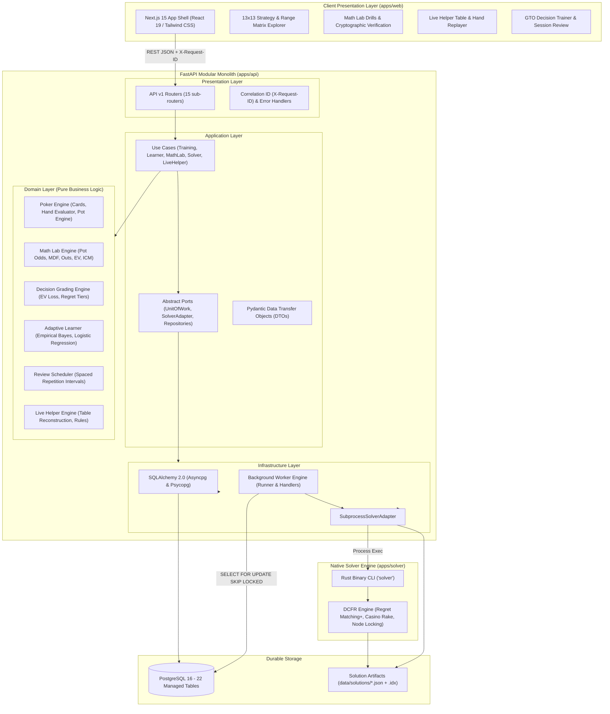
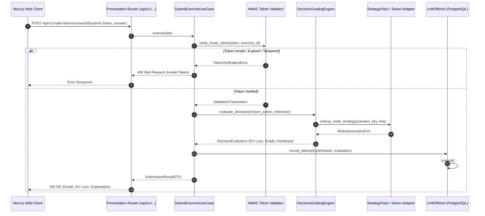
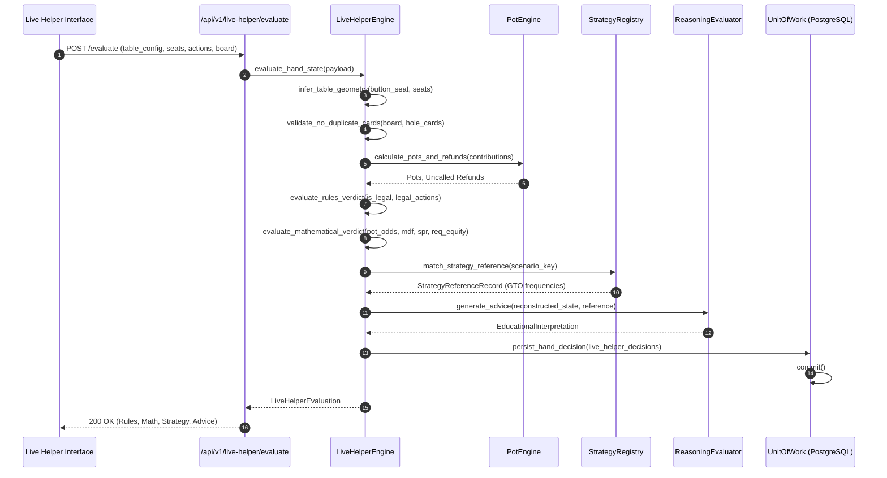

# Pokeria — System Architecture Documentation

## 1. System Vision & Architecture Overview

Pokeria is an open-source, self-hosted poker training, mathematical mastery, and adaptive analysis platform. It combines a high-performance native Rust Discounted Counterfactual Regret Minimization (DCFR) solver, a Python FastAPI Clean Architecture backend, an interactive Next.js 15 (React 19) web shell, and a Bayesian personalization engine.



---

## 2. Clean Architecture Layering & Dependency Rules

Pokeria enforces a 4-tier Clean Architecture model with strict inward dependency rules:

```
┌────────────────────────────────────────────────────────┐
│                      PRESENTATION                      │
│   FastAPI Routers, Middleware, Pydantic Request Models │
└───────────────────────────┬────────────────────────────┘
                            │ imports
┌───────────────────────────▼────────────────────────────┐
│                      APPLICATION                       │
│   Use Cases, Transaction Ports (UnitOfWork), DTOs      │
└───────────────────────────┬────────────────────────────┘
                            │ imports
┌───────────────────────────▼────────────────────────────┐
│                        DOMAIN                          │
│   Pure Poker Entities, Mathematics, Grading, Invariants│
└───────────────────────────▲────────────────────────────┘
                            │ implements
┌───────────────────────────┴────────────────────────────┐
│                    INFRASTRUCTURE                      │
│   SQLAlchemy Models, PostgreSQL Repositories, Worker   │
└────────────────────────────────────────────────────────┘
```

### 2.1. Dependency Rules
1. **Domain Layer (`apps/api/app/domain/`)**:
   - Contains pure business logic, invariants, and mathematical rules.
   - **Zero framework imports**: Must not import FastAPI, SQLAlchemy, Alembic, or external HTTP clients.
   - Pure domain models: `HandStrength`, `Pot`, `ICMResult`, `DecisionEvaluation`, `ReviewSchedule`.
2. **Application Layer (`apps/api/app/application/`)**:
   - Coordinates use cases, transaction orchestration (`UnitOfWork`), and application-level exceptions.
   - Defines abstract repository interfaces and service ports (`SolverAdapter`, `TrainingRepository`).
3. **Infrastructure Layer (`apps/api/app/infrastructure/`)**:
   - Implements database persistence via SQLAlchemy 2.0 (`asyncpg` and `psycopg`).
   - Manages background worker runners, job handlers, and subprocess solver execution.
4. **Presentation Layer (`apps/api/app/presentation/`)**:
   - FastAPI routers, request validation, authentication, correlation ID middleware, and response serialization.

### 2.2. Architectural Boundary Verification & Known Discrepancies
Automated boundary tests (`tests/architecture/test_boundaries.py`) continuously audit imports using Python AST parsing. The audit tracks three known boundary leaks scheduled for refactoring:
- `apps/api/app/domain/math_lab/service.py`: Directly imports SQLAlchemy models and sessions.
- `apps/api/app/domain/repositories/live_helper_repo.py`: Directly imports live helper ORM models.
- `apps/api/app/application/use_cases/live_helper_session_use_cases.py`: Directly imports SQLAlchemy attributes.

---

## 3. Core Domain Subsystems

### 3.1. Texas Hold'em Core Engine (`apps/api/app/domain/poker/`)
* **Cards & Hands**: 64-bit card bitmasks, deterministic 7-card best-5 evaluation, and Two-Plus-Two lookup verification passing all $2,598,960$ 5-card combinations against Treys.
* **Pot & Side-Pot Accounting**: Chip conservation law, uncalled bet calculation, discrete tiered pots, and standard casino/TDA clockwise odd-chip allocation.
* **Tournament ICM & Equity**: Malmuth-Harville dynamic programming over subsets ($O(2^K \cdot K)$), bubble factor asymmetry, risk premiums, and PKO bounty-to-chip conversion.

### 3.2. Solver Integration (`apps/solver/` & `subprocess_solver.py`)
* **DCFR Engine**: Native Rust solver with parameter tuning ($\alpha=1.5, \beta=0, \gamma=2.0$) and regret matching+.
* **Casino Rake Non-Zero-Sum Formulation**: Enforces unilateral best-response gains ($\Delta_0 \ge 0, \Delta_1 \ge 0 \implies \text{NashConv} \ge 0$), preventing negative exploitability artifacts.
* **Byte-Offset Seeking (`NodeMapIndexer`)**: Instant random-access retrieval across large (>200MB) postflop solution trees without in-memory parsing delays.

### 3.3. Decision Grading Authority (`apps/api/app/domain/training/grading.py`)
* Computes real EV regret against equilibrium:
  $$\Delta \text{EV} = \max_a \text{EV}(a) - \text{EV}(a_{\text{chosen}})$$
* Assigns verified categorical grades: Strong ($\le 0.10$), Acceptable ($\le 0.50$), Inaccuracy ($\le 1.50$), Mistake ($\le 4.00$), and Blunder ($> 4.00$).
* **Fails closed with `UNGRADED`** if the solver run did not converge, an action is illegal, or reference EV data is corrupted.

### 3.4. Adaptive Learner & Spaced Repetition (`apps/api/app/domain/learner/`)
* **Empirical Bayes Prior Shrinkage**: Global default prior $p_0 = 0.30$, user shrinkage $M=5.0$, family shrinkage $S=3.0$.
* **Supervised Learning**: Pure Python L2-regularized logistic regression with analytical gradients and Z-score standardization.
* **Cold-Start Safety Gate**: Falls back to `RULE_BASED_BASELINE` whenever learner observations $N < 5$.
* **Review Scheduler**: Conservative interval advancement ($[1, 3, 7, 14, 30]$ days) based on measured decision EV loss.

---

## 4. End-to-End Execution Lifecycles

### 4.1. Exercise-Submission Lifecycle (Math Lab & Drills)



### 4.2. Live Helper Hand Lifecycle



---

## 5. Persistence & Background Queue Architecture

```mermaid
graph LR
    subgraph FastAPI_Process ["API Process"]
        JobSubmit["SubmitJobUseCase"]
    end

    subgraph Postgres_Storage ["PostgreSQL 16"]
        JobsTable[("jobs table<br/>status: pending, running, completed<br/>payload, result, retries")]
        HeartbeatTable[("worker_heartbeats table<br/>status: healthy, offline<br/>last_heartbeat_at")]
    end

    subgraph Worker_Process ["Worker Process"]
        Poller["Job Poller<br/>SELECT ... FOR UPDATE SKIP LOCKED"]
        OrphanReclaim["Orphan Job Recovery<br/>locked_at > 300s timeout"]
        HeartbeatBeat["Heartbeat Writer<br/>every 5.0 seconds"]
        Executor["Task Handlers<br/>- demonstration_task<br/>- solve_scenario<br/>- train_learner_model"]
    end

    JobSubmit -->|INSERT job (ACID)| JobsTable
    Poller -->|Lock Next Pending Job| JobsTable
    OrphanReclaim -->|Reclaim Stale Jobs| JobsTable
    HeartbeatBeat -->|Update Heartbeat| HeartbeatTable
    Poller --> Executor
    Executor -->|UPDATE job status & result| JobsTable
```

1. **ACID Queueing**: Jobs are inserted into PostgreSQL inside the same atomic database transaction that updates application state.
2. **Zero Split-Brain**: Row-level locking (`SELECT ... FOR UPDATE SKIP LOCKED`) ensures multiple concurrent workers never process the same job.
3. **Crash Resilience**: If a worker process dies abruptly, `recover_orphaned_jobs()` detects the expired lock timeout ($300$ seconds) and returns the job to `pending` status.
