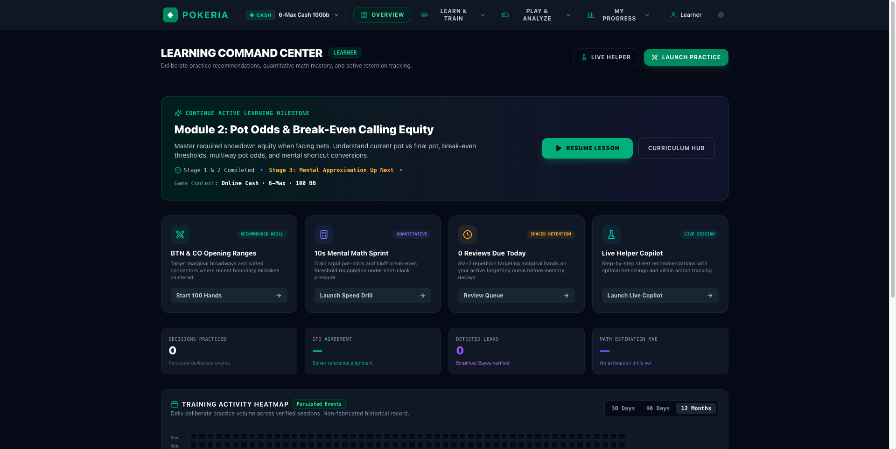
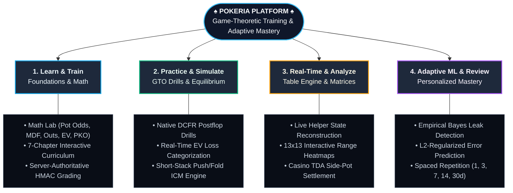

# Pokeria

[](LICENSE)
[](https://www.python.org/)
[](https://nextjs.org/)
[](https://www.postgresql.org/)
[](https://www.rust-lang.org/)

**Pokeria** is a professional, self-hosted poker training, mathematical mastery, and adaptive game-theory analysis platform. Engineered with Clean Architecture, a native Rust Discounted Counterfactual Regret Minimization (DCFR) solver, and server-authoritative verification, Pokeria bridges deep poker game theory with deliberate, structured learning.



---


## Key Pillars & Capabilities

Pokeria is structured around four primary pillars of poker skill development:




### 1. Learn & Train (Curriculum & Math Lab)
- **Math Lab**: Rapid-fire interactive training on calling pot odds, expected value (EV), minimum defense frequency (MDF) & bluff auto-profit thresholds, draw probabilities (combinatorics and Rule of 2 & 4), implied odds, and Progressive Knockout (PKO) tournament bounty equity.
- **Server-Authoritative Cryptographic Grading**: Challenge submissions are signed with server-issued HMAC-SHA256 state tokens, ensuring answers are graded against authentic server-calculated truth rather than client-manipulated payloads.
- **7-Chapter Curriculum**: Structured courses covering table positions, hand rankings, pot odds, effective stack visualizers, and betting round timelines.

### 2. Practice & Simulation
- **GTO Decision Trainer**: Interactive street-by-street drills evaluating decisions against native DCFR solver game trees.
- **Authentic EV Loss Grading**: Real-time evaluation of pure and mixed strategy frequencies, EV sacrifice in chips, and blunder classification (Strong, Acceptable, Inaccuracy, Mistake, Blunder).
- **Short-Stack Push/Fold Engine**: Native equilibrium solver for tournament 5bb-25bb situations under Chip-EV and Malmuth-Harville ICM.

### 3. Real-Time Table & Analysis Tools
- **Live Helper Engine**: Authoritative real-time hand reconstruction, pot and side-pot accounting with uncalled wager detection, standard casino/TDA odd-chip allocation, and multi-verdict analysis (Rules, Math, Strategy, Advice).
- **Interactive 13x13 Range Matrix Explorer**: Preflop and postflop strategy heatmaps supporting mixed action frequencies, sizing breakdowns, and condition filters.
- **Strategy Reference Catalog**: High-throughput storage of GTO solutions with byte-offset seek maps (`NodeMapIndexer`) for sub-100ms node retrieval across large (>200MB) game trees.

### 4. Adaptive Mastery & Review
- **Bayesian Personalization**: Beta-Bernoulli conjugate model with Empirical Bayes shrinkage ($M=5.0$) and hierarchical scenario-family shrinkage ($S=3.0$) to prevent sample-size volatility.
- **Supervised Error Prediction**: Pure-Python L2-regularized logistic regression predicting mistake probabilities with analytical gradients and Z-score normalization.
- **Deterministic Spaced Repetition**: Conservative review interval progression (`[1, 3, 7, 14, 30]` days) based on measured solver EV regret.
- **Anti-Leakage Data Provenance**: Filters out audit fixtures, test profiles, unvalidated solver runs, and corrupted EV records from learner training sets.

---

## Technology Stack

| Component | Technologies |
| :--- | :--- |
| **Frontend Web Shell** | Next.js 15.5.18, React 19.0.0, TypeScript 5.7, Tailwind CSS 3.4.16, Lucide React |
| **Backend API** | FastAPI 0.115, Python 3.12+, Pydantic 2.9, Clean Architecture (`Domain`, `Application`, `Infrastructure`, `Presentation`) |
| **Persistence** | PostgreSQL 16 Alpine, SQLAlchemy 2.0 (Asyncpg & Psycopg), Alembic (16 schema migrations) |
| **Solver Core** | Native Rust DCFR engine (`apps/solver/`), regret matching+, non-zero-sum casino rake (5% cap), node locking |
| **Queue & Worker** | PostgreSQL-backed durable worker queue (`SELECT ... FOR UPDATE SKIP LOCKED`), crash recovery, heartbeats |
| **Containerization** | Multi-stage Dockerfiles (`apps/api/Dockerfile`, `apps/worker/Dockerfile`, `apps/web/Dockerfile`), Docker Compose |
| **Quality & Testing** | Pytest 8.3+, Ruff 0.7+, Mypy (strict), Vitest 2.1.8, Playwright 1.49+ |

---

## Network Endpoints & Ports

### Canonical Defaults (`.env.example`)
| Service | Container Port | Default Host Port | URL / Interface |
| :--- | :--- | :--- | :--- |
| **Web Frontend** | 3000 | `3000` | [http://localhost:3000](http://localhost:3000) |
| **Backend API** | 8000 | `8000` | [http://localhost:8000](http://localhost:8000) |
| **Swagger UI** | 8000 | `8000` | [http://localhost:8000/docs](http://localhost:8000/docs) |
| **API Health Probe** | 8000 | `8000` | [http://localhost:8000/api/v1/health](http://localhost:8000/api/v1/health) |
| **PostgreSQL Database**| 5432 | `5432` | `localhost:5432` |

### Non-Conflicting Local Host Mapping (`.env`)
If your development machine has existing services running on ports 3000 or 5432, `.env` supports remapped host ports:
* **Web**: `http://localhost:3011` (`WEB_PORT=3011`)
* **API**: `http://localhost:8011` (`API_PORT=8011`)
* **PostgreSQL**: `localhost:5439` (`DB_PORT=5439`)

---

## Quick Start (Docker)

The fastest and most reliable way to run the entire Pokeria platform is using Docker Compose:

```bash
# 1. Clone repository
git clone https://github.com/cbaezp/Pokeria.git
cd Pokeria

# 2. Configure environment
cp .env.example .env

# 3. Start all services in the background
docker compose up -d

# 4. Verify that all services started cleanly
docker compose ps
```

Once running:
- Open [http://localhost:3000](http://localhost:3000) (or `http://localhost:3011` if using remapped ports).
- API health check: [http://localhost:8000/api/v1/health](http://localhost:8000/api/v1/health).

To shut down services cleanly:
```bash
docker compose down
# WARNING: Never add -v unless you explicitly intend to wipe your PostgreSQL database volume.
```

---

## Local Development Workflow

### Prerequisites
- Python 3.12+ (managed with `pyenv` or `uv`)
- Node.js 20+ & `npm`
- Docker (for local PostgreSQL service)

### 1. Python Virtual Environment
```bash
python3 -m venv .venv
source .venv/bin/activate
pip install -e ".[dev]"
```

### 2. Frontend Dependencies
```bash
cd apps/web
npm install
cd ../..
```

### 3. Database Initialization
```bash
# Start PostgreSQL service in Docker
docker compose up -d postgres

# Apply all Alembic schema migrations
alembic upgrade head
```

### 4. Running the Development Stack
You can start all three services (API, Worker, Web) with a single command:
```bash
./scripts/dev.sh
```

Or start them individually in separate terminals:
```bash
# Terminal 1: Backend API
source .venv/bin/activate
export PYTHONPATH=apps/api:$PYTHONPATH
uvicorn app.main:app --host 0.0.0.0 --port 8000 --reload

# Terminal 2: Durable Background Worker
source .venv/bin/activate
export PYTHONPATH=apps/api:$PYTHONPATH
python3 -m apps.worker.main

# Terminal 3: Next.js Frontend
cd apps/web && npm run dev
```

---

## Automated Verification & Testing

Pokeria maintains over 380 automated tests spanning pure domain logic, solver convergence, and frontend interfaces:

```bash
# 1. Run all backend unit tests (Fast, in-memory)
pytest tests/unit/ -v

# 2. Run mathematical engine tests specifically
pytest tests/unit/poker/test_math.py -v

# 3. Run full automated test suite (backend + vitest + playwright)
./scripts/test.sh

# 4. Run comprehensive code formatting, linting, and build gates
./scripts/check.sh
```

---

## Repository Layout

```
Pokeria/
├── apps/
│   ├── api/                  # FastAPI Modular Monolith
│   │   ├── app/
│   │   │   ├── domain/       # Pure poker entities, math, grading & learner algorithms
│   │   │   ├── application/  # Use cases, DTOs & transaction ports (Unit of Work)
│   │   │   ├── infrastructure/ # PostgreSQL models, repositories, solver adapter & worker
│   │   │   └── presentation/ # REST API v1 routers, OpenAPI schemas & middlewares
│   │   ├── bin/              # Directory for compiled solver binaries
│   │   └── migrations/       # Alembic schema migrations (16 versions)
│   ├── solver/               # Native Rust DCFR Solver
│   │   ├── cli/              # Standalone CLI ('solver solve', 'solver show')
│   │   └── engine/           # Pure Rust DCFR library, rake model & node locking
│   ├── web/                  # Next.js 15 App Shell (React 19, Tailwind CSS)
│   └── worker/               # Background task consumer entrypoint
├── data/
│   └── solutions/            # GTO solution artifacts & manifest.json catalog
├── docs/                     # Technical architecture, math, solver & operations guides
├── scripts/                  # Development, migration, verification & audit scripts
├── tests/                    # Unit, integration, audit & boundary test suites
├── docker-compose.yml        # Multi-container local orchestration
├── pyproject.toml            # Python packaging & test configurations
└── README.md
```

---

## Mathematical Limits & Disclaimers

1. **Static vs. Dynamic EV**: Pot odds and Minimum Defense Frequency (MDF) equations assume single-street decisions. Real multi-street equilibrium EV realization diverges from static equity due to position, betting leverage, and board runouts.
2. **Casino Rake Non-Zero-Sum Modeling**: Rake extracts money from pots, creating a non-zero-sum game. Pokeria uses unilateral best-response evaluations ($\text{NashConv} \ge 0$) to eliminate negative exploitability artifacts.
3. **When Pokeria Returns UNGRADED**: If a solver run did not converge (`UNVALIDATED_SOLVER_RUN`), an illegal action was chosen (`ILLEGAL_ACTION`), or tournament prize equity lacks converted thresholds (`CSTE_POLICY_PENDING`), Pokeria explicitly assigns `UNGRADED`. It never manufactures artificial numbers.
4. **Educational Ranges vs. Exact GTO**: Preflop charts marked `ILLUSTRATIVE_PRACTICE_CHART` simplify mixed frequencies into actionable human heuristics and should not be mistaken for unsimplified solver solutions.

---

## Documentation Index

Detailed engineering references are located in the [docs/](docs/) directory:

* [Development Roadmap (M1–M9)](docs/ROADMAP.md)
* [System Architecture Guide](docs/architecture.md)
* [Poker Mathematics, Equity & ICM](docs/math-and-equity.md)
* [Poker Engine & Hand Evaluation](docs/poker-engine.md)
* [Solver Engineering & DCFR](docs/solver.md)
* [Adaptive Learner & ML Personalization](docs/adaptive-learner.md)
* [Configuration & Environment Variables](docs/configuration.md)
* [Data & Persistence Architecture](docs/data-and-persistence.md)
* [Getting Started Guide](docs/getting-started.md)
* [Local Development Guide](docs/development.md)
* [Testing & Verification Guide](docs/testing.md)
* [Deployment & Operations Guide](docs/deployment.md)
* [Architecture Decision Records (ADRs)](docs/adr/)

---

## Development Roadmap

Pokeria follows a milestone-based open-source roadmap prioritizing mathematical truth and learner trust:

* **M1 — Mathematical Correctness & Reliability** *(Critical)*: Closed-form property tests, casino rake boundaries, and side-pot split accounting.
* **M2 — Learning Quality & Educational Effectiveness** *(Critical)*: Reverse implied odds, out discounting, and isomorphic board transfer drills.
* **M3 — Adaptive Learning & ML Hardening** *(High)*: Empirical Bayes shrinkage ($M=5.0$), cluster-robust leak detection, and decay-scaled spaced repetition.
* **M4 — Solver-Validated Strategy Coverage** *(High)*: High-capacity disk node indexing (`NodeMapIndexer`) and 6-max cash preflop 3-bet/4-bet libraries.
* **M5 — Universal Hand History Analysis** *(High)*: Multi-site hand history parsing (GGPoker, Winamax, iPoker, WPN) with automated EV-loss reviews.
* **M6 — Tournament Specialization & ICM Dynamics** *(High)*: Short-stack push/fold equilibrium, PKO bounty chip conversions, and final-table risk premiums.
* **M7 — UX Ergonomics & High-Volume Practice** *(Medium)*: Keyboard-first hotkeys (`F`/`C`/`R`/`A`), mobile responsive table geometries, and speed drills.
* **M8 — Open-Source Release Engineering** *(High)*: Automated clean Docker lifecycle, Alembic zero-data-loss migration tests, and Ruff/Biome pre-commit checks.
* **M9 — Long-Term Applied Research** *(Future)*: Real-time turn/river subgame resolving and empirical human population tendency modeling.

Read the full milestone breakdown, capability matrix, and acceptance criteria in [**docs/ROADMAP.md**](docs/ROADMAP.md).

---

## Attributions & Upstream Acknowledgments

Pokeria's native postflop solving engine (`apps/solver/`) is built upon and vendored from the open-source [postflop](https://github.com/ucsandman/postflop) project by **Wes Sander** (`ucsandman`), licensed under the [MIT License](apps/solver/LICENSE).

Pokeria extends and patches the upstream engine to include:
- Unilateral deviation gain evaluation for non-zero-sum casino rake games ($\text{NashConv} \ge 0$).
- Action-conditional EV export and node strategy extraction for real-time decision grading.
- Byte-offset node map indexers (`NodeMapIndexer`) for high-throughput random seeking across large (>200MB) solution trees.

---

## Contributing

We welcome contributions from both **human developers** and **developers collaborating with AI coding agents**:

* **For Human Contributors**: Please read [**CONTRIBUTING.md**](CONTRIBUTING.md) and [**DEVELOPMENT.md**](docs/development.md) for architectural guidelines, setup steps, and PR conventions.
* **For AI Coding Agents**: Consult the mandatory root directive in [**AGENTS.md**](AGENTS.md) and domain-specific blueprints in [**.agents/**](.agents/):
  - [Architecture Boundaries](.agents/architecture.md)
  - [Poker Mathematics](.agents/poker-math.md)
  - [Solver Validation](.agents/solver-validation.md)
  - [Learning & ML Integrity](.agents/learning-and-ml.md)
  - [Specialized Workflows](.agents/workflows/) (Features, Bug Fixes, Exercises, PR Reviews)

All pull requests must pass local tests and code quality checks (`ruff`, `biome`, and `tsc`) before submission.

---

## Authors & License

Created and maintained by [**cbaezp**](https://github.com/cbaezp).

* **Repository**: [https://github.com/cbaezp/Pokeria](https://github.com/cbaezp/Pokeria)
* **Issues & Discussions**: [https://github.com/cbaezp/Pokeria/issues](https://github.com/cbaezp/Pokeria/issues)

Distributed under the MIT License. See [LICENSE](LICENSE) for details.
