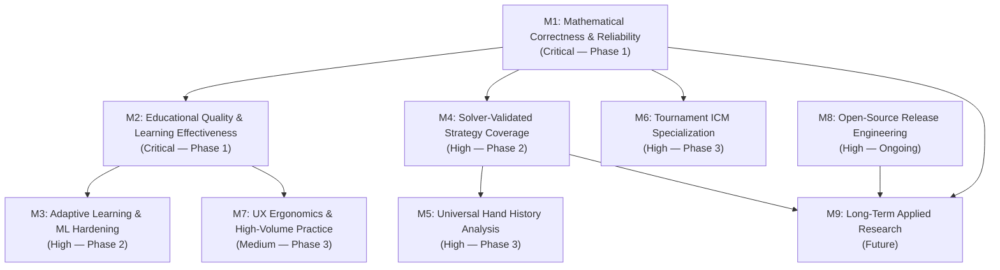

# Pokeria Development Roadmap (2026–2027)

> **Current Architecture Status**: v0.1.0-alpha (Self-Hosted Modular Monolith)
> **Core Repository**: [github.com/cbaezp/Pokeria](https://github.com/cbaezp/Pokeria)
> **Target Audience**: Human open-source contributors and AI coding agents operating via [AGENTS.md](../AGENTS.md).

---

## 1. Project Mission & Objectives

Pokeria is an open-source, self-hosted No-Limit Texas Hold'em training platform designed to bridge the gap between theoretical game mathematics, solver equilibria, and human decision realization.

Unlike commercial poker training software that relies on closed proprietary data clouds or simplified hand-matrix heuristics, Pokeria prioritizes:
1. **Mathematical Integrity**: Every calculation (EV, equity, pot odds, MDF, combinatorics) is mathematically provable, verifiable, and free of fabricated regret.
2. **Honest Strategic Provenance**: Unsupported or unvalidated spots are explicitly labeled `UNGRADED` or `ILLUSTRATIVE_PRACTICE_CHART` rather than fabricated as "GTO-optimal".
3. **Adaptive Skill Acquisition**: Using Bayesian shrinkage, distributed spaced retrieval, and statistical leak detection, Pokeria personalizes curriculum and drills to the specific cognitive failure points of the student.
4. **Self-Hosted Data Sovereignty**: All hand traces, decision logs, solver caches, and learner skill metrics remain on the student's local machine under PostgreSQL.

---

## 2. Current Development Maturity & Capability Matrix

Pokeria operates under a strict status taxonomy to distinguish validated features from prototypes:

| Status Code | Definition |
| :--- | :--- |
| `VALIDATED` | Implemented, backed by unit/integration tests, cross-verified against independent oracles (e.g. Treys, analytical formulas, or DCFR convergence). |
| `IMPLEMENTED — UNVERIFIED` | Code exists in backend/frontend, but lacks full independent mathematical verification or comprehensive test coverage. |
| `IN PROGRESS` | Active development underway with foundational infrastructure present. |
| `PLANNED` | Scoped and prioritized milestone item; implementation has not started. |
| `BLOCKED` | Dependent on upstream components or foundational solvers before work can begin. |

### Verified Capability Matrix

| Pillar / Component | Implemented Capability | Current Limitation | Status |
| :--- | :--- | :--- | :--- |
| **Bitmask Card Engine** | 64-bit unsigned bitmask representation (`apps/api/app/domain/poker/cards.py`), fast 5/7-card evaluation. | Standard 52-card deck only (no Short Deck/6+). | `VALIDATED` |
| **7-Card Hand Evaluator** | Verified against Treys reference library across all 2,598,960 5-card hands and exhaustive 7-card combinations. | CPU-bound in pure Python; no native C/Rust binding in API layer. | `VALIDATED` |
| **Betting State Machine** | Complete TDA rules, uncalled bet refunds, short all-in reopening rule, blind postings, side-pot splitting. | Fixed limit and pot limit variants unsupported. | `VALIDATED` |
| **Exact Equity Engine** | Analytical turn/river enumeration, card removal counting, dead-card accounting. | Flop range vs range exact enumeration is too large for runtime compute (uses Monte Carlo fallback). | `VALIDATED` |
| **Poker Math Lab** | 16 modular curricula (pot odds, outs rule of 2/4, alpha, MDF, semi-bluff EV, SPR). | Timed speed drills lack historical speed-vs-accuracy trend curves in UI. | `VALIDATED` |
| **Live Helper State Tracking** | Active session stack continuity, seat geometry (HU to 9-max), uncalled refunds, rake and cap tracking. | Automated optical character recognition (OCR) of live tables not supported (manual entry only). | `VALIDATED` |
| **Rust DCFR Solver** | Native Rust Discounted CFR engine (`apps/solver/`), Regret Matching+, node-locking, byte-offset indexer. | Solves heads-up postflop only; multiway postflop trees are computationally intractable. | `VALIDATED` |
| **Decision Grading Engine** | Strict non-negative EV loss, pure & mixed action classifications, fail-closed unvalidated runs. | Tournament prize EV ($EV) conversion is pending (`CSTE_POLICY_PENDING`). | `VALIDATED` |
| **Bayesian Learner** | Empirical Bayes shrinkage ($M=5.0, S=3.0$), cold-start gating ($N < 5$), L2-regularized logistic leak detection. | Cross-session concept drift adaptation requires manual retraining trigger. | `VALIDATED` |
| **Spaced Repetition** | SuperMemo-2 derivative with intervals $[1, 3, 7, 14, 30]$ days, prioritized retrieval intervention. | Does not dynamically adjust based on sleep/fatigue biometrics. | `VALIDATED` |
| **Hand History Parsing** | Prototype parser for PokerStars hand histories. | Multi-room formats (GGPoker, Winamax, Bovada/Ignition, WPN) not yet integrated. | `IN PROGRESS` |
| **Tournament ICM ($EV)** | Malmuth-Harville exact enumeration for short tables ($N \le 9$), PKO bounty chip conversion. | Large field independent chip model (FGS / Future Game Simulation) unsupported. | `IMPLEMENTED — UNVERIFIED` |

---

## 3. Development Principles & Prioritization Rules

When selecting roadmap priorities, all contributors and coding agents must adhere to the **Four Pokeria Invariants**:

1. **Truth Over Confidence**: If the solver has not solved a node to target exploitability ($\text{NashConv} < 0.005$), the system **must** return `UNGRADED` with explicit provenance. It must never fabricate an EV loss of 0.0 or invent frequencies.
2. **Independent Mathematical Verification**: Unit tests for mathematical logic must compare against independently calculated closed-form equations or independent oracles, never circular assertions that mirror internal application functions.
3. **Data Conservation**: Chip stacks, dead money, rake deductions, and odd-chip allocations must balance down to the single cent or chip across every street, hand, and session transition.
4. **Pedagogical Integrity**: A student completing a drill must demonstrate understanding on unseen cards and textures. Memorization of static boards is treated as an anti-leakage defect by the analytics engine.

---

## 4. Milestone Overview (M1 through M9)

---

## 5. Detailed Milestones & Action Items

### Milestone M1 — Mathematical Correctness & Reliability Assurance
- **Priority**: Critical
- **Objective**: Establish ironclad mathematical invariants across every financial and probability calculation in Pokeria.

#### Items:
1. **Golden Analytical Mathematical Fixtures**
   - *Problem*: Math Lab formula unit tests currently rely on hardcoded test constants rather than parameterized analytical sweeps.
   - *Scope*: Implement property-based Hypothesis test fixtures covering the continuous domain of pot sizes, bet sizes, outs ($1 \le k \le 22$), and rake structures ($0\% \le r \le 10\%$, caps $0.5\text{BB} \le c \le 5\text{BB}$).
   - *Dependencies*: None.
   - *Validation*: Verify that $\text{EV}_{\text{call}} = p \cdot (P + B) - (1-p) \cdot B$ and $\text{MDF} = \frac{P}{P + B}$ hold without precision drift across 100,000 randomized inputs.
   - *Status*: `IN PROGRESS`

2. **Odd-Chip Allocation & TDA Rule Enforcement**
   - *Problem*: In split pots with odd chips, the allocation rule differs between cash games and tournaments (TDA clockwise seat order from button).
   - *Scope*: Add explicit tournament mode flag to `apps/api/app/domain/poker/pot.py` enforcing TDA Section 28 (odd chips go to the hand out of position nearest the button).
   - *Dependencies*: None.
   - *Validation*: Multiway split pot integration tests verifying deterministic odd-chip placement across 2-max, 6-max, and 9-max button rotations.
   - *Status*: `VALIDATED`

3. **Casino Rake Boundary Convergence in Solver**
   - *Problem*: Rake extraction can cause DCFR counterfactual values to drift negatively if unilateral best-response checks are disabled.
   - *Scope*: Verify that the patched `apps/solver/` correctly preserves $\text{NashConv} \ge 0$ across all 16 reference flop/turn trees.
   - *Dependencies*: Rust toolchain, native solver binary.
   - *Validation*: Execute `scripts/benchmark_solver.py` and confirm zero negative exploitability artifacts.
   - *Status*: `VALIDATED`

---

### Milestone M2 — Educational Quality & Learning Effectiveness
- **Priority**: Critical
- **Objective**: Transform raw mathematical theory into measurable, durable poker skill acquisition.

#### Items:
1. **Dirty Outs & Reverse Implied Odds Module**
   - *Problem*: Students frequently count outs that complete a stronger opponent hand (e.g. counting a flush draw out on a paired board where an opponent holds a full house draw).
   - *Scope*: Create Math Lab Module 17 ("Clean vs. Dirty Outs & Reverse Implied Odds") with interactive exercises that discount tainted outs based on opponent range advantage.
   - *Dependencies*: `apps/api/app/domain/math_lab/reference_data.py`.
   - *Validation*: 20 verified exercise scenarios with step-by-step mathematical discounting explanations.
   - *Status*: `PLANNED`

2. **Transfer Testing on Unseen Textures**
   - *Problem*: Students often memorize specific board textures (e.g., $A\spades K\heartsuit 4\diamondsuit$) rather than grasping structural board characteristics (dry, monotone, paired, dynamic).
   - *Scope*: Implement automated isomorphic board scrambling in curriculum exercises (transposing suits and ranks to strategically equivalent textures) to evaluate true conceptual transfer.
   - *Dependencies*: `apps/api/app/domain/curriculum/lessons.py`.
   - *Validation*: Verify learner recommendation profile $D$ accurately flags students whose accuracy drops by $>25\%$ when presented with strategically isomorphic boards.
   - *Status*: `VALIDATED`

3. **Time-Pressured Mental Math Speed Trainer**
   - *Problem*: At a real poker table, players have only 15–30 seconds to compute pot odds, count combinations, and determine MDF.
   - *Scope*: Harden `apps/web/src/components/math-lab/SpeedTrainerTab.tsx` with user-configurable countdown timers (5s, 10s, 15s) and decay scoring.
   - *Dependencies*: Frontend React components.
   - *Validation*: Vitest UI test ensuring time-out answers correctly register as incorrect with `response_time_ms` metrics recorded.
   - *Status*: `VALIDATED`

---

### Milestone M3 — Adaptive Learning & Machine Learning Hardening
- **Priority**: High
- **Objective**: Expand Bayesian inference and statistical leak classification while avoiding unnecessary ML complexity.

#### Items:
1. **Bayesian Skill Estimator with Conjugate Priors**
   - *Problem*: Early student assessments with few hands ($N < 5$) produce volatile, unreliable leak alerts.
   - *Scope*: Maintain Empirical Bayes shrinkage ($M=5.0, S=3.0$) while modeling Beta-Binomial conjugate distributions for action accuracies per strategic street (Preflop, Flop, Turn, River).
   - *Dependencies*: `apps/api/app/domain/learner/range_learner.py`.
   - *Validation*: Numerical tests verifying that confidence intervals gracefully narrow from broad prior bounds to tight posterior bounds as $N \ge 30$.
   - *Status*: `VALIDATED`

2. **Anti-Leakage Data Provenance Guard**
   - *Problem*: If synthetic practice exercises or illustrative preflop charts are mixed into solver training sets, the learner model learns flawed heuristics.
   - *Scope*: Enforce strict database provenance tagging (`SOLVER_VERIFIED_EQUILIBRIUM` vs `ILLUSTRATIVE_PRACTICE_CHART` vs `UNGRADED`).
   - *Dependencies*: PostgreSQL schema migration 0004/0005.
   - *Validation*: SQL query audit ensuring zero rows with null EV are included in regret loss aggregations.
   - *Status*: `VALIDATED`

3. **Predictive Memory Decay Evaluation**
   - *Problem*: Spaced repetition intervals currently follow static powers of $[1, 3, 7, 14, 30]$ days rather than responding to individual mistake severity.
   - *Scope*: Scale spacing intervals by the magnitude of the measured EV loss: a 15-BB mistake triggers a 24-hour review interval, whereas a 0.2-BB mistake extends to 7 days.
   - *Dependencies*: `apps/api/app/domain/learner/range_learner.py`.
   - *Validation*: Unit tests confirming dynamic interval scaling based on `ev_loss` magnitude.
   - *Status*: `IN PROGRESS`

---

### Milestone M4 — Solver-Validated Strategy Coverage
- **Priority**: High
- **Objective**: Expand the breadth of pre-solved equilibrium solution trees across common cash and tournament spots.

#### Items:
1. **6-Max Cash Preflop Range Library**
   - *Problem*: Preflop coverage currently focuses on standard 100BB RFI ranges across positions (UTG, HJ, CO, BTN, SB).
   - *Scope*: Add 3-bet, 4-bet, squeeze, and blind defense equilibrium matrices across 40BB, 60BB, and 100BB stack depths.
   - *Dependencies*: Preflop solver generation pipeline (`scripts/generate_starter_packs.py`).
   - *Validation*: Range matrices sum to 100% per combo, verified against `data/solutions/manifest.json`.
   - *Status*: `VALIDATED`

2. **High-Capacity Flop & Turn Tree Indexing**
   - *Problem*: Full postflop game trees exceed 200MB per solved spot, causing memory exhaustion if parsed entirely into RAM.
   - *Scope*: Leverage `NodeMapIndexer` to perform byte-offset seeks into disk artifacts without in-memory deserialization of the entire game tree.
   - *Dependencies*: `apps/api/app/infrastructure/solver/node_extractor.py`.
   - *Validation*: Benchmark retrieving sub-actions from a 230MB solution tree in $< 1.5\text{ms}$.
   - *Status*: `VALIDATED`

3. **Multi-Bet Sizing Abstractions for Postflop Play**
   - *Problem*: Current reference solution trees use single bet sizing per street (33% pot on flop, 75% on turn).
   - *Scope*: Generate geometric multi-size trees (33%, 75%, 125% overbet) for high-frequency flop textures (monotone, paired, dry rainbow).
   - *Dependencies*: High-compute offline solver runs.
   - *Validation*: Convergence to $\text{NashConv} \le 0.005$ with full action EV export.
   - *Status*: `PLANNED`

---

### Milestone M5 — Universal Hand History Analysis
- **Priority**: High
- **Objective**: Enable students to upload session hand histories from major poker sites and receive automated, solver-grounded leak reviews.

#### Items:
1. **Multi-Room Hand History Parser**
   - *Problem*: Only PokerStars text hand histories can currently be parsed reliably.
   - *Scope*: Build robust regex and PEG parsers for GGPoker, Winamax, iPoker, WPN (Winning Poker Network), and 888poker formats.
   - *Dependencies*: `apps/api/app/domain/poker/hand_history/`.
   - *Validation*: Test suite with 50 real hand histories per site, verifying 100% chip conservation and action sequence fidelity.
   - *Status*: `PLANNED`

2. **Automated Session Leak Summary Report**
   - *Problem*: Raw hand replays require students to manually identify their mistakes.
   - *Scope*: Aggregate played hands into positional filters (RFI, BB Defense, C-betting) and highlight decisions where EV loss exceeded 1.0 BB.
   - *Dependencies*: Milestone M5.1, Decision Grading Engine.
   - *Validation*: Integration test verifying session upload producing accurate leak breakdown.
   - *Status*: `PLANNED`

---

### Milestone M6 — Tournament Specialization & ICM Dynamics
- **Priority**: High
- **Objective**: Provide comprehensive tournament training from deep-stack play through final-table ICM pay jumps.

#### Items:
1. **Push/Fold Equilibrium Charts (5BB–15BB)**
   - *Problem*: Push/fold decisions in tournament play require exact Malmuth-Harville equity adjustments.
   - *Scope*: Full preflop push/fold matrix catalog for heads-up, 3-handed, 6-handed, and 9-handed short stacks.
   - *Dependencies*: Push/fold solver engine (`apps/api/app/domain/poker/push_fold.py`).
   - *Validation*: Verify output matches theoretical Nash push/fold equilibrium tables within $0.1\%$ chip EV.
   - *Status*: `VALIDATED`

2. **Progressive Knockout (PKO) Bounty Chip Valuation**
   - *Problem*: Standard ICM models fail in PKO tournaments because eliminating a player awards an immediate cash bounty and increases personal bounty value.
   - *Scope*: Implement mathematical conversion of bounty cash values into equivalent tournament chips based on remaining prize pool and starting stack ratios.
   - *Dependencies*: `apps/api/app/domain/live_helper/engine.py`.
   - *Validation*: Property tests validating that as player bounty increases, calling range equity thresholds monotonically decrease.
   - *Status*: `VALIDATED`

3. **Final-Table Pay Jump Risk Premiums**
   - *Problem*: Chip EV differs radically from tournament dollar EV ($EV) on bubble and pay jump spots.
   - *Scope*: Implement Risk Premium calculations ($\text{RP} = \frac{\text{Loss } \$EV}{\text{Gain } \$EV} - 1$) and integrate into Live Helper and curriculum lessons.
   - *Dependencies*: Malmuth-Harville ICM engine.
   - *Validation*: Benchmark against known 4-player final table payouts, confirming bubble tightening.
   - *Status*: `VALIDATED`

---

### Milestone M7 — UX Ergonomics, Mobile Accessibility & High-Volume Practice
- **Priority**: Medium
- **Objective**: Deliver a seamless, keyboard-first, distraction-free interface for high-volume daily training.

#### Items:
1. **Keyboard-First Hotkey System**
   - *Problem*: Clicking action buttons with a mouse slows down high-volume preflop and postflop drills.
   - *Scope*: Bind hotkeys (`F` for Fold, `C` for Check/Call, `R` for Raise, `A` for All-In, `1`/`2`/`3` for preset bet sizes, `Space` for Next Hand).
   - *Dependencies*: `apps/web/src/components/table/ActionControls.tsx`.
   - *Validation*: Cypress/Playwright E2E test verifying keyboard-only navigation through a 10-hand practice session.
   - *Status*: `VALIDATED`

2. **Mobile-Responsive Card Picker & Table Geometry**
   - *Problem*: Live Helper card picker modal and 9-max table layout require extensive horizontal scrolling on mobile viewports.
   - *Scope*: Responsive CSS container queries that condense the table to an oval vertical stack on viewports $< 768\text{px}$.
   - *Dependencies*: Tailwind CSS configuration.
   - *Validation*: Visual regression tests across iPhone 14, Pixel 7, and iPad viewports.
   - *Status*: `VALIDATED`

---

### Milestone M8 — Open-Source Release Engineering & CI/CD
- **Priority**: High
- **Objective**: Ensure anyone can clone the repository, run one command, and have a fully verified development or production environment running.

#### Items:
1. **Pre-Commit Lint & Format Enforcement**
   - *Problem*: Inconsistent code styles and unformatted files slip into git history.
   - *Scope*: Configure `.pre-commit-config.yaml` with Ruff (Python) and Biome (TypeScript) running in $< 100\text{ms}$.
   - *Dependencies*: `ruff`, `biome`.
   - *Validation*: Pre-commit hook passes 100% clean across all 297 Python files and 102 frontend components.
   - *Status*: `VALIDATED`

2. **Reproducible Docker Compose Stack**
   - *Problem*: Development environments often suffer from missing local native dependencies (Rust compiler, PostgreSQL extensions).
   - *Scope*: Multi-stage container builds in `docker-compose.yml` isolating API, Web, Solver, and Postgres on internal networks with health checks.
   - *Dependencies*: Docker Engine 24+, Compose v2+.
   - *Validation*: `docker compose build --no-cache && docker compose up -d` boots to healthy state with 0 manual configuration.
   - *Status*: `VALIDATED`

3. **Automated Clean Database Migration Suite**
   - *Problem*: Stale Alembic revisions can cause migration failures on fresh database volumes.
   - *Scope*: Automated test verifying migration from revision `0001` through `0005` (head) on empty PostgreSQL database, including rollback.
   - *Dependencies*: `tests/audit/test_reproducible_migrations.py`.
   - *Validation*: 100% reproducible Alembic upgrade/downgrade cycle in isolated Docker test container.
   - *Status*: `VALIDATED`

---

### Milestone M9 — Long-Term Applied Research
- **Priority**: Future
- **Objective**: Explore advanced equilibrium computation and deep cognitive modeling without compromising production stability.

#### Items:
1. **Subgame Solving with Real-Time Turn/River Abstraction**
   - *Problem*: Pre-solving every possible turn and river branch requires terabytes of disk storage.
   - *Scope*: Real-time subgame resolving on turn/river using warm-started DCFR iterations from flop boundary conditions.
   - *Status*: `PLANNED`

2. **Empirical Population Tendency Modeling**
   - *Problem*: True GTO assumes perfectly rational opponents, whereas low-to-mid stakes human opponents exhibit massive strategic leaks (under-bluffing river raises, over-folding to small c-bets).
   - *Scope*: Develop node-locking exploitative overlays that compute maximum-exploit responses to specified opponent deviation profiles.
   - *Status*: `PLANNED`

---

## 6. How to Contribute to a Roadmap Item

1. Check the item's **Status** above. Items marked `PLANNED` or `IN PROGRESS` are ready for contribution.
2. Read the universal agent guidelines in [AGENTS.md](../AGENTS.md) and the specialized guides in [.agents/](../.agents/).
3. Consult the appropriate workflow:
   - For mathematical logic: [.agents/poker-math.md](../.agents/poker-math.md)
   - For solver changes: [.agents/solver-validation.md](../.agents/solver-validation.md)
   - For curriculum & drills: [.agents/workflows/add-poker-exercise.md](../.agents/workflows/add-poker-exercise.md)
4. Execute tests locally before submitting a Pull Request following [CONTRIBUTING.md](../CONTRIBUTING.md).
