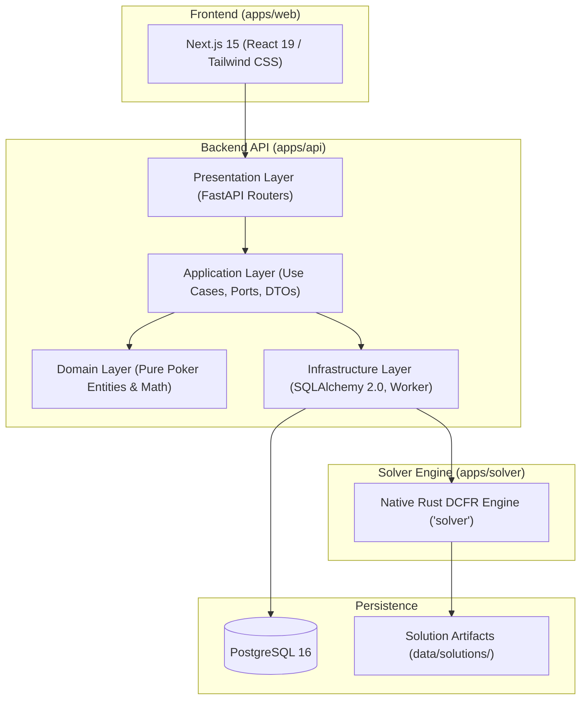

# Pokeria — Architecture Guide

## 1. Clean Architecture Modular Monolith

Pokeria is built as a Clean Architecture modular monolith backed by high-performance auxiliary engines (native Rust DCFR solver and PostgreSQL worker queues).

---

## 2. Layer Responsibilities & Boundaries

1. **Domain Layer (`apps/api/app/domain/`)**:
   - Pure business logic, invariants, and mathematical entities (e.g. Card, Hand, Equity, Math Lab calculations, Pot Odds, ICM, Decision Grading).
   - Zero framework dependencies (no FastAPI, SQLAlchemy, or HTTP libraries).
2. **Application Layer (`apps/api/app/application/`)**:
   - Coordinates use cases, transaction orchestration (`UnitOfWork`), and application-level exceptions.
   - Defines abstract repository interfaces and service ports.
3. **Infrastructure Layer (`apps/api/app/infrastructure/`)**:
   - Implements database persistence via SQLAlchemy 2.0 (`asyncpg` and `psycopg`).
   - Manages background worker jobs, transaction commits, and native solver process execution.
4. **Presentation Layer (`apps/api/app/presentation/`)**:
   - FastAPI routers, request validation, authentication, correlation ID middleware (`X-Request-ID`), and response serialization.

---

## 3. Solver Engine & Strategy Tree Pipeline

- **Rust Solver (`apps/solver/`)**: Discounted Counterfactual Regret Minimization (DCFR) engine capable of computing heads-up postflop equilibrium strategies with non-zero-sum casino rake support.
- **Precomputed Tree Catalog (`data/solutions/`)**: Precomputed game trees indexed by board texture, pot size, and preflop action sequence in `manifest.json`.
- **Node Map Indexer (`NodeMapIndexer`)**: Byte-offset seek reader serving sub-100ms strategy evaluations during practice drills across solution files exceeding 200MB.

---

## 4. Frontend Architecture (`apps/web/`)

- Built with **Next.js 15** and **React 19** using the App Router.
- State management leverages React hooks, local storage sync, and server-side state synchronization.
- Component library utilizes Tailwind CSS with customized poker color-coding (suits, frequencies, EV loss tiers).
- Unit and component tests run via **Vitest** configured with process forks (`pool: "forks"`) and isolated JSDOM cleanup.

---

## 5. Detailed Architectural Documentation

For specialized subsystems and operational workflows, refer to the following dedicated architecture guides:
* [Poker Mathematics & Equity](math-and-equity.md)
* [Poker Engine & Hand Evaluation](poker-engine.md)
* [Solver Engineering & DCFR](solver.md)
* [Adaptive Learner & ML Personalization](adaptive-learner.md)
* [Data & Persistence Architecture](data-and-persistence.md)
* [Deployment & Operations Guide](deployment.md)
* [Architecture Decision Records (ADRs)](adr/)
