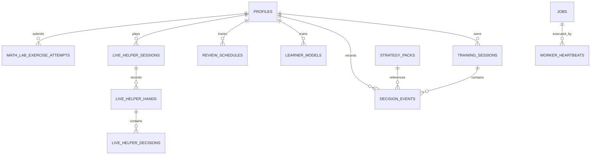

# Data & Persistence Architecture

## 1. Relational Persistence Overview

Pokeria uses a durable, relational persistence architecture built on **PostgreSQL 16** and managed via **SQLAlchemy 2.0** with **Alembic** schema migrations.

All database state is stored in the `postgres_data` Docker volume. Hand evaluations, learner diagnostics, training decisions, and background queue jobs benefit from ACID transaction guarantees.

---

## 2. PostgreSQL Relational Schema

The database consists of 22 managed tables:



### 2.1. Core Entities
* **`profiles`**: User profiles (`id`, `username`, `email`, `created_at`, `updated_at`, `is_primary`, `settings`).
* **`jobs`**: Durable asynchronous background task queue (`id`, `job_type`, `status`, `payload`, `result`, `retries_remaining`, `lock_token`, `locked_at`, `created_at`).
* **`worker_heartbeats`**: Worker lifecycle tracking (`worker_id`, `status`, `last_heartbeat_at`, `metadata`).

### 2.2. Strategy & Training
* **`strategy_packs`**: GTO reference solutions (`id`, `name`, `scenario_key`, `board`, `oop_range`, `ip_range`, `starting_pot`, `effective_stack`, `exploitability_chips`, `exploitability_pct_of_pot`, `root_evs`, `artifact_path`, `artifact_checksum`, `node_count`, `engine_version`, `validation_status`).
* **`training_sessions`**: Practice drill sessions (`id`, `profile_id`, `game_type`, `objective`, `status`, `current_index`, `scenarios`).
* **`decision_events`**: Individual training choices (`id`, `session_id`, `profile_id`, `scenario_id`, `action_chosen`, `amount_chosen`, `raw_ev_loss`, `grade_category`, `grading_status`, `grading_provenance`, `solver_status`, `created_at`).

### 2.3. Learner Modeling & Spaced Repetition
* **`learner_models`**: Serialized ML models (`id`, `profile_id`, `family`, `weights`, `bias`, `feature_names`, `brier_score`, `log_loss`, `status`, `created_at`).
* **`learner_datasets`**: Causal point-in-time training sets with SHA-256 fingerprints (`id`, `fingerprint`, `observation_count`, `manifest`, `created_at`).
* **`learner_recommendations_history`**: Historical recommendations served to learners (`id`, `profile_id`, `scenario_id`, `category`, `reason`, `served_at`).
* **`review_schedules`**: Spaced repetition tracking (`id`, `profile_id`, `scenario_id`, `interval_days`, `review_count`, `consecutive_successes`, `next_review_due`).
* **`assessment_items`**: Diagnostic question bank items.
* **`assessment_sessions`**: Formal diagnostic testing sessions.
* **`assessment_responses`**: User responses during assessments.
* **`assessment_reservations`**: Item locking during assessment flows.
* **`assessment_experiments`**: Policy and model evaluation tracking.

### 2.4. Live Helper & Math Lab
* **`live_helper_scenarios`**: Reusable table setups and drill templates.
* **`live_helper_sessions`**: Live session tracking.
* **`live_helper_hands`**: Hands played in live sessions.
* **`live_helper_decisions`**: In-hand decisions, table geometry, and advice.
* **`math_lab_exercise_attempts`**: Interactive math drill submissions.
* **`math_lab_user_progress`**: Topic proficiency and streak counters.
* **`math_lab_retention_items`**: Spaced repetition retention items for mathematical formulas.

---

## 3. Migration History (Alembic)

Schema evolution is strictly versioned in `apps/api/migrations/versions/`:

1. `0001_initial_schema.py`: Base tables (`profiles`, `jobs`).
2. `0002_worker_heartbeats.py`: Worker node registration and liveness heartbeats.
3. `0003_strategy_packs.py`: GTO solver solution metadata and checksums.
4. `0004_training_sessions.py`: Training sessions and drill decision tracking.
5. `0005_decision_events_unique.py`: Idempotency constraints on decision recording.
6. `0006_learner_models.py`: Serialized ML model storage.
7. `0007_observation_provenance_and_active_model_idx.py`: Data provenance filters and model indexing.
8. `0008_assessment_and_retention.py`: Item banks, review schedules, and spaced repetition.
9. `0009_strategy_pack_metadata.py`: Extended solver diagnostics and bet trees.
10. `0010_allow_high_volume_scenarios.py`: Large scenario array scaling.
11. `0011_per_occurrence_idempotency.py`: Re-drill idempotency support.
12. `0012_preflop_strategy_modes_and_learner_tracking.py`: Preflop range tracking and modes.
13. `0013_protect_primary_user_profile.py`: Invariant protecting primary profile from deletion.
14. `0014_live_helper_scenarios.py`: Live Helper scenario persistence.
15. `0015_live_helper_sessions.py`: Live Helper hands, seats, and decisions.
16. `0016_math_lab_persistence.py`: Math Lab exercise attempts, topic mastery, and retention.

---

## 4. Concurrency & Worker Queue Architecture

Located in `apps/api/app/infrastructure/worker/runner.py`.

Pokeria implements a durable PostgreSQL-backed worker queue without requiring Redis or Celery:

### 4.1. Row-Level Locking (`FOR UPDATE SKIP LOCKED`)
Workers poll pending jobs using atomic row-level locking:
```sql
SELECT id FROM jobs
WHERE status = 'pending'
ORDER BY created_at ASC
FOR UPDATE SKIP LOCKED
LIMIT 1;
```
This guarantees that multiple worker processes or threads can consume jobs concurrently without race conditions or duplicate execution.

### 4.2. Crash Recovery & Orphan Reclamation
If a worker container crashes while processing a job:
* Every active worker maintains a timestamped heartbeat (`worker_heartbeats`).
* When a worker starts or polls, it runs `recover_orphaned_jobs()`:
```sql
UPDATE jobs
SET status = 'pending', lock_token = NULL, locked_at = NULL, retries_remaining = retries_remaining - 1
WHERE status = 'running'
  AND locked_at < NOW() - INTERVAL '300 seconds'
  AND retries_remaining > 0;
```
Interrupted jobs are automatically recovered and retried up to their retry limits.

---

## 5. Backup & Disaster Recovery

### 5.1. Creating a Database Dump
To create a clean SQL backup from the running container:
```bash
docker compose exec -T postgres pg_dump -U pokerlab pokerlab_dev > backup_$(date +%Y%m%d_%H%M%S).sql
```

### 5.2. Restoring from a Backup
```bash
# 1. Stop application containers to prevent active writes
docker compose stop api worker web

# 2. Restore database from dump
docker compose exec -T postgres psql -U pokerlab pokerlab_dev < backup_file.sql

# 3. Restart application containers
docker compose start api worker web
```
