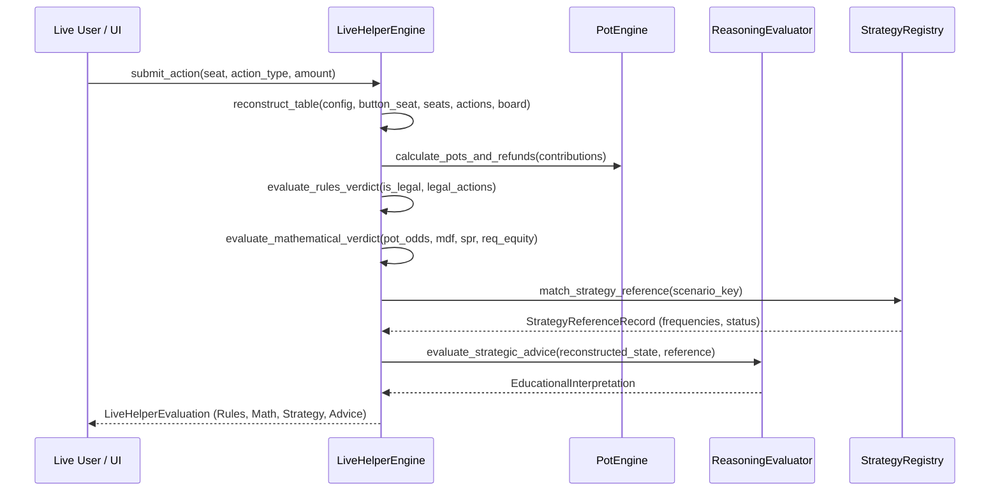

# Poker Engine Architecture & State Machine

## 1. Architectural Scope

The Poker Engine (`apps/api/app/domain/poker/` and `apps/api/app/domain/live_helper/`) contains pure domain logic for Texas Hold'em. It operates with zero dependencies on web frameworks or databases.

All chip financial operations are conducted strictly in integer units to prevent floating-point rounding errors.

---

## 2. Card Representation & Hand Evaluation

Located in `apps/api/app/domain/poker/cards.py` and `evaluator.py`.

### 2.1. Card Bitmasks & Data Types
Each card is an immutable value object defined by `Rank` (Two through Ace) and `Suit` (Clubs, Diamonds, Hearts, Spades).

A 52-card standard deck is represented using 64-bit integer bitmasks, enabling:
- $O(1)$ set intersection checks (card collision and removal).
- Conflict-free dead-card tracking across hole cards and community boards.

### 2.2. Hand Ranking Hierarchy
Hands are evaluated into a typed `HandStrength` object containing:
1. `category`: One of 9 canonical hand classes (High Card to Straight Flush).
2. `tie_breakers`: Tuple of integer ranks for deterministic comparison.
3. `description`: Human-readable label (e.g., `"Flush, Ace High"`).

```
Category 9: Straight Flush (includes Royal Flush)
Category 8: Four of a Kind
Category 7: Full House
Category 6: Flush
Category 5: Straight (handles A-2-3-4-5 wheel straight)
Category 4: Three of a Kind
Category 3: Two Pair
Category 2: One Pair
Category 1: High Card
```

### 2.3. Exhaustive Verification Against Treys Reference
The evaluator includes cross-validation against the industry standard `treys` evaluation library and passes exhaustive combinatorial validation across all $\binom{52}{5} = 2,598,960$ 5-card permutations:
- Full frequency distribution match:
  - High Card: 1,302,540 (50.1177%)
  - One Pair: 1,098,240 (42.2569%)
  - Two Pair: 123,552 (4.7539%)
  - Three of a Kind: 54,912 (2.1128%)
  - Straight: 10,200 (0.3925%)
  - Flush: 5,108 (0.1965%)
  - Full House: 3,744 (0.1441%)
  - Four of a Kind: 624 (0.0240%)
  - Straight Flush: 40 (0.0015%)

For 7-card evaluation (flop + turn + river + hole cards), the engine evaluates all $\binom{7}{5} = 21$ combinations in $O(1)$ time and extracts the optimal 5-card subset.

---

## 3. Pot & Side-Pot Accounting Engine

Located in `apps/api/app/domain/poker/pot.py`.

### 3.1. Chip Conservation Law
The pot engine enforces strict chip conservation:
$$\sum_{i=1}^N \text{Initial Stack}_i = \sum_{i=1}^N \text{Final Stack}_i + \text{Rake}$$
No chip can be created or destroyed during hand execution.

### 3.2. Uncalled Wagers & Tiered Side Pots
When players bet differing amounts and one or more players go all-in:
1. **Uncalled Wager Detection**: If a player's total contribution exceeds the maximum contribution of any other player in the hand, the excess is immediately returned to them before pots are partitioned.
2. **Tiered Pot Decomposition**:
   - The remaining contributions are sliced into discrete tiers based on ascending all-in thresholds.
   - For each tier, a `Pot` object is created containing the accumulated chips and the set of eligible player IDs who have not folded.
   - Contiguous pots with identical eligible player sets are consolidated into a single pot.

```
Example: 3-Way All-in Hand
Player A: Contributes 100 chips (All-in)
Player B: Contributes 250 chips (All-in)
Player C: Contributes 300 chips (Active caller)

Step 1: Player C uncalled wager = 300 - 250 = 50 chips refunded immediately.
Step 2: Tier 1 (0 to 100 chips):
        Player A: 100
        Player B: 100
        Player C: 100
        Main Pot = 300 chips (Eligible: A, B, C)
Step 3: Tier 2 (100 to 250 chips):
        Player B: 150
        Player C: 150
        Side Pot 1 = 300 chips (Eligible: B, C)
```

---

## 4. Showdown Settlement & Odd-Chip Rules

Located in `PotEngine.settle_showdown()` in `apps/api/app/domain/poker/pot.py`.

### 4.1. Split-Pot Division
When multiple eligible contenders achieve identical hand strengths:
$$\text{Base Share} = \lfloor \frac{\text{Pot Amount}}{\text{Contender Count}} \rfloor$$
$$\text{Odd Chips} = \text{Pot Amount} \pmod{\text{Contender Count}}$$

### 4.2. Official Casino / TDA Odd-Chip Priority
To eliminate arbitrary tie-breaking, Pokeria strictly follows the Tournament Directors Association (TDA) and standard casino ruleset:
- **Odd chips are awarded one-by-one to tied winners in clockwise order starting from the first player to the left of the dealer button.**
- In heads-up play, the small blind (button) acts first postflop; the big blind is the first position clockwise from the button.

---

## 5. Table Geometry & Positional Invariants

Located in `apps/api/app/domain/poker/seat_geometry.py`.

Pokeria supports variable table sizes from 2-max (Heads-Up) to 9-max (Full Ring):

| Table Size | Positional Order (Clockwise from Button) |
| :--- | :--- |
| **Heads-Up (2-max)** | `BTN` (SB), `BB` |
| **3-max** | `BTN`, `SB`, `BB` |
| **6-max** | `BTN`, `SB`, `BB`, `UTG`, `MP`, `CO` |
| **9-max** | `BTN`, `SB`, `BB`, `UTG`, `UTG+1`, `MP`, `LJ`, `HJ`, `CO` |

### Invariant Rules
- In Heads-Up, the dealer button posts the Small Blind and acts first preflop, but acts last on all postflop streets.
- If players sit out or leave, positions are dynamically re-indexed relative to the active dealer button.

---

## 6. Live Helper State Reconstruction & Engine

Located in `apps/api/app/domain/live_helper/engine.py`.

The Live Helper reconstructs real-time table state from raw action histories:



### Multi-Verdict Structure
1. **`RulesVerdict`**: Enforces table rules (valid bet sizes, min-raise calculations, all-in caps).
2. **`MathematicalVerdict`**: Pure financial numbers (current pot, pot odds percentage, required equity, MDF, SPR).
3. **`StrategicVerdict`**: Solver equilibrium matching (frequency of check/bet/raise from reference pack).
4. **`EducationalInterpretation`**: Contextual reasoning (e.g., explaining why a high-frequency c-bet is warranted by board texture and range advantage).
